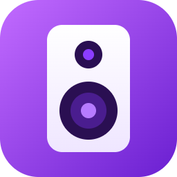
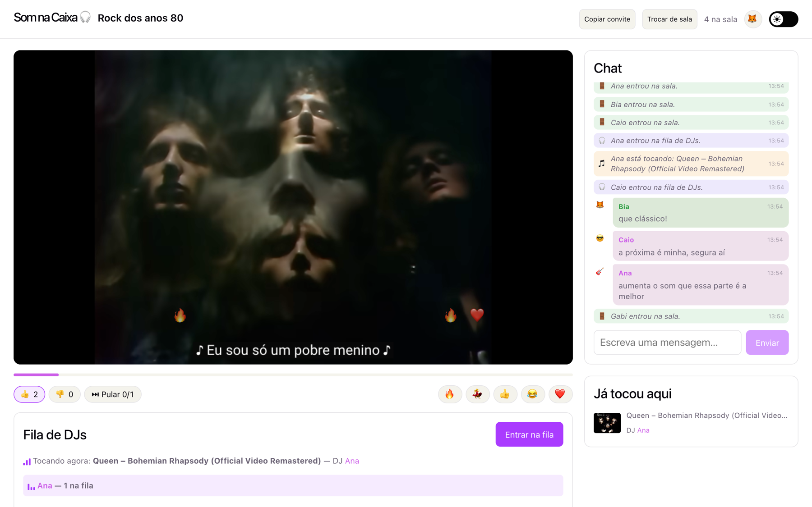
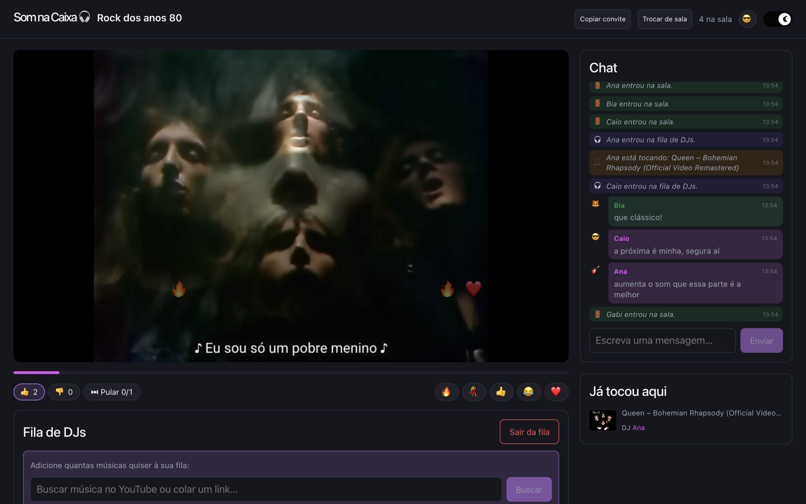
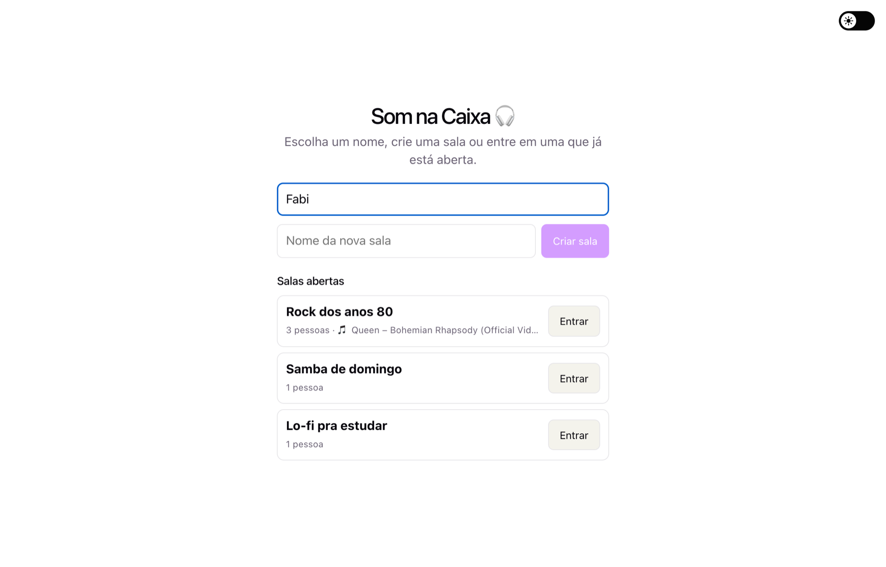
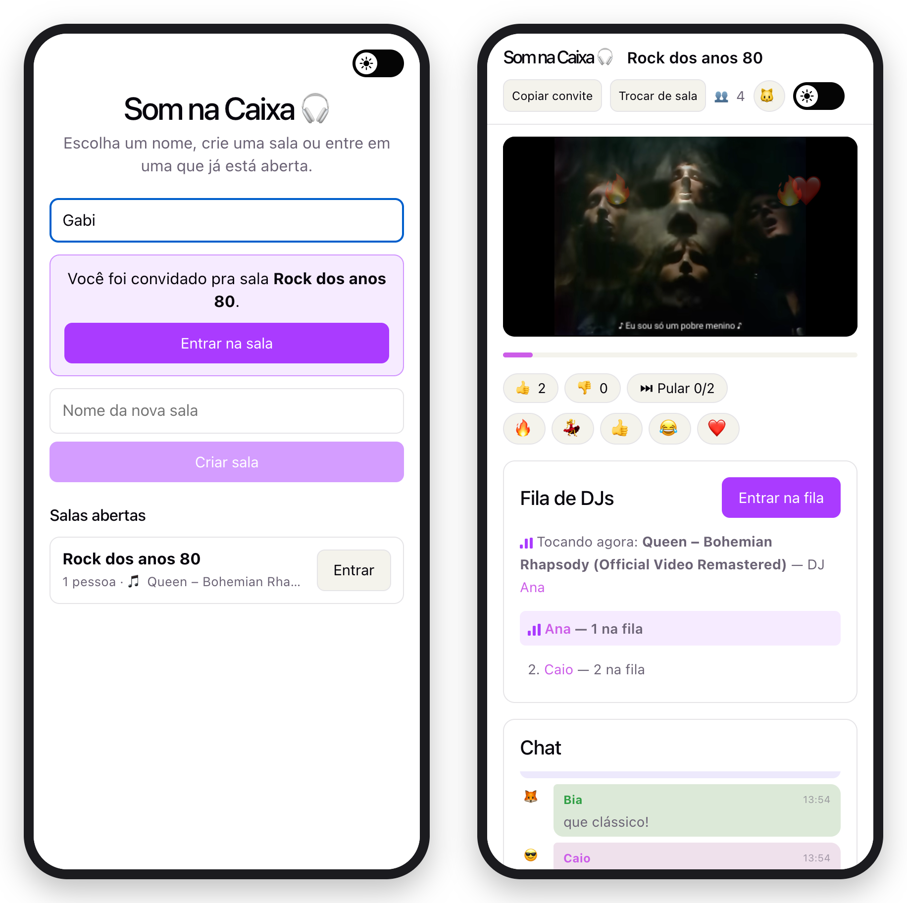

<p align="center">
  
</p>

<h1 align="center">Som na Caixa</h1>

<p align="center">
  Salas de música para ouvir junto com os amigos.<br>
  Cada um põe a sua música do YouTube, todo mundo ouve no mesmo segundo e conversa no chat.
</p>

<p align="center">
  <a href="https://som-na-caixa.onrender.com"><b>▶︎ Abrir o Som na Caixa</b></a>
  &nbsp;·&nbsp; no navegador, no computador ou no celular &nbsp;·&nbsp; sem cadastro &nbsp;·&nbsp; grátis
</p>

<p align="center">
  
</p>

---

## Índice

- [O que ele faz](#o-que-ele-faz)
- [Primeiros passos](#primeiros-passos)
- [Dentro da sala](#dentro-da-sala)
- [Convidar alguém](#convidar-alguém)
- [No celular](#no-celular)
- [Limites e regras](#limites-e-regras)
- [Privacidade](#privacidade)
- [Problemas comuns](#problemas-comuns)
- [Rodar no seu computador](#rodar-no-seu-computador)
- [Publicar a sua própria versão](#publicar-a-sua-própria-versão)
- [Testes](#testes)
- [Como funciona por dentro](#como-funciona-por-dentro)
- [Estrutura do código](#estrutura-do-código)
- [Licença](#licença)

---

## O que ele faz

O Som na Caixa é uma releitura do antigo plug.dj: uma sala onde as pessoas se revezam como DJ e
todo mundo ouve a mesma música ao mesmo tempo.

- **Salas abertas**: qualquer pessoa cria uma sala com o nome que quiser. A página inicial mostra
  todas as salas abertas, com quantas pessoas tem em cada uma e o que está tocando.
- **Fila de DJs**: quem entra na fila monta a própria lista de músicas, buscando no YouTube ou
  colando um link. Na sua vez, a próxima música da sua lista toca sozinha para a sala inteira.
- **Tudo sincronizado**: o vídeo começa no mesmo ponto para todo mundo, inclusive para quem chega
  no meio da música, e se acerta sozinho se alguém ficar para trás.
- **Votos**: 👍 e 👎 na música que está tocando, e voto para pular. A música é pulada quando metade
  de quem está ouvindo vota.
- **Chat e reações**: mensagens com cor e ícone de cada pessoa, avisos de quem entrou ou começou a
  tocar, e emojis que sobem flutuando por cima do vídeo.
- **Histórico**: as últimas 50 músicas que tocaram na sala, com o DJ e o placar de votos.
- **Convite por link**: um botão copia o link da sala para mandar no WhatsApp ou no Discord.
- **Tema claro e escuro**, segue o do sistema ou o que você escolher.
- **Sem cadastro e sem senha**: você só digita um nome. Nada fica guardado no servidor.

<p align="center">
  
</p>

## Primeiros passos

1. Abra **[som-na-caixa.onrender.com](https://som-na-caixa.onrender.com)**.
2. Digite o seu nome. Ele fica salvo no navegador para a próxima vez.
3. Crie uma sala, dando um nome a ela, ou clique em **Entrar** em uma das salas abertas.

<p align="center">
  
</p>

> O site fica num plano gratuito que "dorme" quando ninguém usa. Se ele demorar para abrir, espere
> cerca de um minuto: é o servidor acordando.

## Dentro da sala

### Ser DJ

1. Clique em **Entrar na fila**.
2. Na caixa que aparece, busque uma música (por exemplo, `queen bohemian rhapsody`) e clique em
   **+ Adicionar**, ou cole um link do YouTube e aperte Enter.
3. Adicione quantas quiser, até 20, a qualquer momento, sem esperar a sua vez. Arraste para
   mudar a ordem e use **Remover** para tirar uma música.
4. Quando chega a sua vez, a primeira música da sua lista começa a tocar sozinha. Se a lista
   estiver vazia, a caixa fica destacada e o título da aba pisca "Sua vez de tocar!".
5. Enquanto a sua música toca, você pode pular ela na hora com **Pular minha música**.

Quem sai da fila perde a lista que estava montando.

### Votar

| Botão | O que faz |
|---|---|
| 👍 | Curti. Aparece no placar da música e fica no histórico |
| 👎 | Não curti. Também vai para o placar e o histórico |
| ⏭ Pular 1/2 | Voto para pular. O número mostra quantos votos tem e quantos são precisos |

São precisos os votos de metade de quem está ouvindo (o DJ não conta), arredondando para cima:
com 3 ouvintes, 2 votos pulam a música. Clicar de novo desfaz o voto. O DJ não vota na própria
música.

### Chat, reações e ícone

- O chat guarda as últimas 100 mensagens da sala, com até 300 caracteres cada.
- Os botões 🔥 💃 👍 😂 ❤️ embaixo do vídeo mandam uma reação que sobe flutuando para todo mundo.
- O botão redondo no topo escolhe o seu ícone entre 16 emojis. Sem ícone, o chat mostra a
  inicial do seu nome numa cor fixa.
- **Trocar de sala** volta para a página inicial, com o seu nome ainda preenchido.

## Convidar alguém

Dentro da sala, clique em **Copiar convite**. O link é algo como
`https://som-na-caixa.onrender.com/?sala=Ab12Cd34`. Quem abre o link vê o convite logo abaixo do
campo de nome e entra com um clique.

O link vale enquanto a sala existir. Quando a última pessoa sai, a sala fecha e o convite avisa
que ela não existe mais.

## No celular

O site se ajusta à tela do celular: o vídeo fica em cima, depois os votos, a fila de DJs, o chat e
o histórico. Não precisa instalar nada.

<p align="center">
  
</p>

## Limites e regras

O site é público, então algumas regras evitam bagunça:

| O quê | Regra |
|---|---|
| Nome da pessoa | Até 24 caracteres. Não pode repetir dentro da mesma sala |
| Nome da sala | Até 40 caracteres. Não pode repetir entre as salas abertas |
| Salas abertas | No máximo 100 ao mesmo tempo |
| Mensagens no chat | 5 seguidas, depois 1 por segundo |
| Reações | 8 seguidas, depois cerca de 3 por segundo |
| Votos | 10 seguidos, depois 2 por segundo |
| Músicas adicionadas | 10 seguidas, depois 1 a cada 2 segundos |
| Criar salas | 3 seguidas, depois 1 a cada 20 segundos |
| Buscas no YouTube | 10 seguidas por IP, depois 1 a cada 10 segundos |

Quem passa de um limite vê o aviso "Calma, você está fazendo isso rápido demais" e só precisa
esperar alguns segundos.

A busca usa a cota gratuita da API do YouTube, que é de cerca de **100 buscas por dia para o site
inteiro**. Buscas repetidas ficam guardadas por 6 horas e não gastam cota. Colar um link não usa
busca nenhuma, então continua funcionando mesmo se a cota acabar.

## Privacidade

- **Não tem conta, e-mail nem senha.** O nome que você digita só existe enquanto você está na sala.
- **O servidor não grava nada em disco.** Salas, chat, filas e histórico ficam na memória: somem
  quando a sala esvazia e todos somem quando o servidor reinicia.
- **No seu navegador** ficam três coisas, para a próxima visita: o nome, o ícone e o tema. Dá para
  apagar limpando os dados do site.
- **O vídeo vem do YouTube.** O player é o oficial do YouTube, carregado direto do site deles.

## Problemas comuns

**O site demora para abrir**

É o servidor gratuito acordando depois de um tempo parado. Leva cerca de um minuto, uma vez só.

**A sala sumiu**

Ela fecha quando a última pessoa sai, e todas fecham quando o servidor reinicia (depois de uma
atualização ou quando ele dorme). É só criar outra.

**A busca deu erro**

A cota do dia acabou ou o limite de buscas seguidas foi atingido. Cole o link do vídeo do
YouTube no mesmo campo: isso não depende da busca.

**Uma música não toca**

Alguns vídeos não permitem ser tocados fora do YouTube. Se a música travar, o DJ pode pular ou a
sala pode votar para pular.

**O vídeo começou sem som**

Alguns navegadores bloqueiam som automático. Clique uma vez no vídeo ou no volume do player.

**A internet caiu**

Se ela voltar em até 20 segundos, você continua na sala sem perder o lugar na fila. Depois disso,
o site volta para a página inicial com o seu nome preenchido.

## Rodar no seu computador

Precisa do [Node.js](https://nodejs.org) 22 ou mais novo.

```bash
git clone https://github.com/marcosznl/som-na-caixa.git
cd som-na-caixa
```

Em dois terminais:

```bash
cd server && npm install && npm run dev
```

```bash
cd client && npm install && npm run dev
```

Abra `http://localhost:5173` em duas abas para ver a sincronização. O servidor fica em
`http://localhost:3001`.

**Busca do YouTube (opcional).** Sem ela, colar links funciona normalmente.

1. Em [console.cloud.google.com](https://console.cloud.google.com), crie um projeto.
2. Em **APIs e Serviços → Biblioteca**, ative a **YouTube Data API v3**.
3. Em **APIs e Serviços → Credenciais → Criar credenciais → Chave de API**, gere uma chave.
4. Copie `server/.env.example` para `server/.env` e cole a chave em `YOUTUBE_API_KEY`.

**Outro aparelho na mesma rede.** Crie `client/.env` com
`VITE_SERVER_URL=http://SEU_IP_LOCAL:3001` e ajuste `CLIENT_ORIGIN` no `server/.env`.

| Variável (`server/.env`) | Para quê | Padrão |
|---|---|---|
| `PORT` | Porta do servidor | `3001` |
| `CLIENT_ORIGIN` | Endereço do front-end em desenvolvimento (CORS) | `http://localhost:5173` |
| `YOUTUBE_API_KEY` | Chave da busca do YouTube | vazia |

## Publicar a sua própria versão

O repositório já vem com um [`render.yaml`](render.yaml) para o [Render](https://render.com):

1. Faça um fork deste repositório.
2. No Render, clique em **New → Blueprint** e escolha o seu fork.
3. Cole a `YOUTUBE_API_KEY` quando ele pedir, ou deixe em branco.
4. Espere o build. O endereço aparece no topo da página do serviço.

Em produção um serviço só entrega o site, a API e o websocket. Cada push na `main` publica a nova
versão sozinho. O plano gratuito do Render dorme depois de uns 15 minutos sem acesso.

## Testes

```bash
npm install --prefix server
npm test
```

São 17 testes, e nenhum usa a internet. Parte deles sobe o servidor de verdade numa porta livre e
conversa com ele pelo Socket.IO, como o navegador faria: criar e entrar em salas, nomes repetidos,
chat, limites, fila pessoal, votos e ícones. Os outros testam as funções puras: o limitador, a
contagem de votos e a leitura dos links do YouTube.

## Como funciona por dentro

- **Servidor** (`server/`): Node.js, Express e Socket.IO. Cada sala é um objeto na memória com a
  fila de DJs, a música atual, os votos, o chat e o histórico. Em produção o mesmo servidor
  entrega o front-end já compilado.
- **Front-end** (`client/`): React e Vite, sem biblioteca de estado nem de componentes. O vídeo
  usa a YouTube IFrame API.
- **Sincronização do vídeo.** Quando uma música começa, o servidor guarda o horário de início
  (`startedAt`). Cada navegador calcula onde o vídeo deveria estar (`agora - startedAt`) e, a cada
  5 segundos, corrige a posição se estiver mais de 1,5 segundo fora.
- **Quando a música acaba.** O navegador do DJ avisa o servidor. Se esse aviso não chegar (aba em
  segundo plano, celular bloqueado), o servidor avança sozinho depois da duração do vídeo mais 15
  segundos.
- **Só manda o que mudou.** As atualizações vão em pedaços separados: uma mensagem de chat manda
  só a mensagem, um voto manda só o estado da música, e cada pessoa recebe só a própria fila.

  | Evento | Quando é enviado | Conteúdo |
  |---|---|---|
  | `lobby:sync` | Para quem está na página inicial, quando algo muda | Salas abertas |
  | `state:sync` | Música, fila de DJs ou votos mudaram | Cabine, música atual, votos |
  | `users:sync` | Alguém entrou, saiu ou trocou de ícone | Pessoas da sala com o ícone |
  | `chat:sync` / `chat:new` | Ao entrar / a cada mensagem | Chat inteiro / uma mensagem |
  | `history:sync` | Uma música começou ou terminou | Músicas que já tocaram |
  | `queue:sync` | A sua fila mudou | A sua fila, só para você |

- **Quedas rápidas.** O Socket.IO recupera a mesma conexão por até 2 minutos, e o servidor espera
  20 segundos antes de tirar alguém da sala. Uma queda curta passa despercebida.
- **Limites.** Cada ação tem um "balde de fichas" por conexão (a busca, por IP): dá para fazer
  algumas vezes seguidas, e depois as fichas voltam aos poucos.

## Estrutura do código

```
server/
  src/index.js          Express, Socket.IO, salas e todos os eventos
  src/roomState.js      Estado de uma sala: fila de DJs, filas pessoais, votos, chat, histórico
  src/rateLimit.js      Limitador por "balde de fichas"
  src/youtubeSearch.js  Busca e duração dos vídeos, com cache
  src/youtube.js        Extrai o ID do vídeo de um link do YouTube
  test/                 Testes (node --test)
client/
  src/App.jsx           Conexão, estado da sala e link de convite
  src/components/       Página inicial (Lobby), sala, player, fila, votos, chat, histórico
render.yaml             Deploy no Render
```

## Licença

O Som na Caixa é distribuído sob a licença [MIT](LICENSE): pode usar, modificar e distribuir,
mantendo o aviso de autoria.

Os vídeos são tocados pelo player oficial do YouTube. As imagens deste README mostram videoclipes
dos respectivos artistas e gravadoras só como exemplo. O Som na Caixa não tem relação com o
YouTube nem com o plug.dj.
